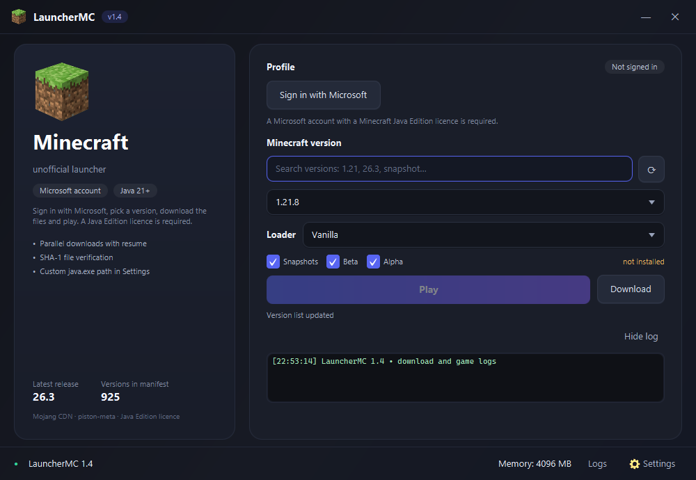

<div align="center">


# LauncherMC

**A portable Minecraft: Java Edition launcher with Microsoft sign-in.**

[](https://www.microsoft.com/link)


[](LICENSE)



[**🇬🇧 English**](#english) · [**🇷🇺 Русский**](#russian)

</div>

---

<a id="english"></a>

## 🇬🇧 English

LauncherMC downloads Minecraft: Java Edition versions from Mojang's public CDN, verifies the files, asks you to sign in with Microsoft and checks your Java Edition licence before launching the official client. Everything is stored in one portable folder.

> **Mojang allow-list:** LauncherMC's Microsoft client ID was approved on **24 November 2026**. Microsoft sign-in works out of the box. Forks or custom client IDs still need their own Mojang approval.

### Features

| | |
|---|---|
| 🔐 **Microsoft sign-in** | OAuth 2.0 device-code flow with a public client ID. The launcher never sees your password and verifies the `product_minecraft` + `game_minecraft` entitlements before launch. |
| 🗂 **Full version catalog** | Releases, snapshots, old beta and alpha from `version_manifest_v2.json` (900+ versions), with search and type filters. |
| ⚡ **Parallel download** | Client, libraries and assets with progress, retries and SHA-1 verification. |
| 🔁 **Repair** | Existing files are checked by size; Repair/Reinstall verifies SHA-1 and re-downloads damaged files. Downloads can be cancelled. |
| ♻️ **Shared libraries** | Libraries are stored once in `versions/libraries` and reused by every version. |
| ☕ **Java auto-selection and download** | Detects installed Java (8/17/21/25) and offers to download Adoptium Temurin JRE when needed. |
| 🧵 **Fabric Loader** | Installs Fabric from Fabric meta, including Maven libraries and inherited parent libraries. |
| 🖥 **Modern UI** | Dark theme, live log, inline errors, English/Russian interface. |
| 📦 **Portable** | Config, accounts, logs, versions and Java stay next to the launcher. |

### Requirements

| Component | Requirement |
|---|---|
| Account | Microsoft account that owns **Minecraft: Java Edition** (Bedrock-only is not enough) |
| Launcher runtime | Java 21+ (bundled in the Windows archive when released) |
| Game runtime | Selected automatically per version: Java 8, 17, 21 or 25 |
| RAM | 2 GB minimum; 8 GB+ recommended |
| Disk | ~300 MB for the launcher + one small version; 2 GB+ for assets |
| OS | Windows 10+, macOS 12+, Linux x86_64 (ARM64 JavaFX included) |

### Microsoft sign-in

The launcher uses its own Microsoft Entra public client ID. No client secret is used; the client ID is not a secret.

Mojang now requires third-party client IDs to be added to an allow-list. A new app can complete Microsoft/Xbox authentication but Minecraft Services rejects it with `403 Invalid app registration` until the application is approved.

- Application process: <https://aka.ms/AppRegInfo>
- The launcher shows a clear dialog with this link when Mojang rejects the client ID.
- The refresh token is stored locally in `launcher_accounts.json`; **Sign out** deletes it.

### Install

Download the latest release:

- Windows: [`windows.zip`](https://github.com/rpmaster2/launchermc-online/releases/latest/download/windows.zip) (JRE 21 included)
- macOS / Linux: [`launchermc.jar`](https://github.com/rpmaster2/launchermc-online/releases/latest/download/launchermc.jar) (Java 21+)

Or build from source below.

### Build from source

Requirements: **JDK 21+**. Maven is provided by the wrapper.

```sh
git clone https://github.com/rpmaster2/launchermc-online.git
cd launchermc-online

# Windows
mvnw.cmd package

# macOS / Linux
./mvnw package
```

Artifacts:

| File | Purpose |
|---|---|
| `target/launchermc-1.4.0-all.jar` | portable executable JAR (JavaFX included) |
| `target/launchermc-1.4.0.jar` | thin JAR |
| `target/launchermc.exe` | Windows launcher (Launch4j) |

### First launch

1. Press **Sign in with Microsoft** and complete the device-code flow at <https://www.microsoft.com/link>.
2. Pick a version and press **Download**.
3. Press **Play**. The launcher verifies your Java Edition licence and starts the official client.

### Storage

```text
LauncherMC/
├─ launchermc.exe
├─ launcher_config.ini       # settings
├─ launcher_accounts.json    # Microsoft refresh token (after sign-in)
├─ logs/
├─ version_manifest.json
├─ java/                     # downloaded JREs (jre-8, jre-25, …)
└─ versions/
   ├─ assets/
   ├─ libraries/
   └─ <version>/
      ├─ <version>.json
      ├─ <version>-client.jar
      ├─ libraries/          # legacy per-version libraries
      ├─ natives/
      ├─ resources/
      └─ saves/
```

### Settings (`launcher_config.ini`)

| Key | Default | Meaning |
|---|---|---|
| `version` | — | Last selected version |
| `allocatedMemory` | `2048` | `-Xmx` in MB |
| `showSnapshots` | `false` | Show snapshots |
| `showBeta` | `true` | Show old beta versions |
| `showAlpha` | `true` | Show old alpha versions |
| `javaPath` | — | Custom Java path; empty = automatic |
| `language` | `auto` | `auto`, `ru`, `en` |
| `loader` | `vanilla` | `vanilla` or `fabric` |
| `microsoftClientId` | built-in | Microsoft Entra client ID override |

### Data sources

| Purpose | Endpoint |
|---|---|
| Version list | `https://piston-meta.mojang.com/mc/game/version_manifest_v2.json` |
| Version metadata / client | URLs from the manifest |
| Libraries | `https://libraries.minecraft.net/…` |
| Assets | `https://resources.download.minecraft.net/<xx>/<hash>` |
| Fabric | `https://meta.fabricmc.net/v2` |
| Java (Adoptium) | `https://api.adoptium.net/v3` |

### Troubleshooting

| Symptom | Solution |
|---|---|
| `Invalid app registration` | Mojang has not allow-listed the client ID. Apply via <https://aka.ms/AppRegInfo>. |
| “No Minecraft Java licence” | The Microsoft account must own Java Edition; Bedrock-only is not enough. |
| Xbox profile / family errors | Create an Xbox profile on xbox.com; child accounts need a Microsoft family group. |
| Version requires Java 25 | The launcher offers to download the required Temurin JRE. |
| Game closes immediately | Open **Logs** and check the last lines. |
| Download is stuck | Press **Cancel** and restart; existing files are skipped. |
| Windows SmartScreen warning | The `.exe` is unsigned; build from source or use the JAR. |

### Privacy

See [PRIVACY.md](PRIVACY.md). No telemetry; the refresh token is stored locally and can be deleted with **Sign out**.

### License & disclaimer

Licensed under the [MIT License](LICENSE).

LauncherMC is **not affiliated with Mojang Studios or Microsoft**. Minecraft is a trademark of Mojang Synergies AB. You must own a legitimate copy of Minecraft: Java Edition to play.

---

<a id="russian"></a>

## 🇷🇺 Русский

LauncherMC скачивает версии Minecraft: Java Edition с официального CDN Mojang, проверяет файлы, требует вход Microsoft и проверяет лицензию Java Edition перед запуском официального клиента. Всё хранится в одной переносимой папке.

> **Mojang allow-list:** client ID приложения LauncherMC одобрен **24 ноября 2026**. Вход Microsoft работает сразу. Форкам и своим client ID всё равно нужно отдельное одобрение Mojang.

### Возможности

| | |
|---|---|
| 🔐 **Вход Microsoft** | OAuth 2.0 device-code с публичным client ID. Пароль не передаётся лаунчеру; перед запуском проверяются `product_minecraft` и `game_minecraft`. |
| 🗂 **Полный каталог версий** | Релизы, снапшоты, старые бета и альфа из `version_manifest_v2.json` (900+ версий), поиск и фильтры. |
| ⚡ **Параллельная загрузка** | Клиент, библиотеки и ассеты с прогрессом, повторами и SHA-1. |
| 🔁 **Ремонт** | Проверка размеров; «Исправить»/«Переустановить» проверяет SHA-1 и докачивает повреждённые файлы. Загрузку можно отменить. |
| ♻️ **Общие библиотеки** | Библиотеки хранятся один раз в `versions/libraries`. |
| ☕ **Автовыбор и скачивание Java** | Находит Java 8/17/21/25 и предлагает скачать Adoptium Temurin JRE. |
| 🧵 **Fabric Loader** | Установка Fabric из meta API, Maven-библиотеки и наследование родительской версии. |
| 🖥 **Современный интерфейс** | Тёмная тема, живой лог, ошибки в окне, RU/EN. |
| 📦 **Портативность** | Конфиг, аккаунт, логи, версии и Java лежат рядом с лаунчером. |

### Требования

| Компонент | Требование |
|---|---|
| Аккаунт | Microsoft-аккаунт с **Minecraft: Java Edition** (только Bedrock не подходит) |
| Для лаунчера | Java 21+ (входит в Windows-архив после релиза) |
| Для игры | Выбирается автоматически: Java 8, 17, 21 или 25 |
| ОЗУ | 2 ГБ минимум; 8 ГБ+ рекомендуется |
| Диск | ~300 МБ на лаунчер и небольшую версию; 2 ГБ+ на ассеты |
| ОС | Windows 10+, macOS 12+, Linux x86_64 (ARM64 JavaFX включён) |

### Вход Microsoft

Лаунчер использует собственный публичный client ID приложения Microsoft Entra. Client secret не используется; client ID не является секретом.

Mojang требует добавить client ID сторонних приложений в allow-list. Новое приложение может пройти Microsoft/Xbox, но Minecraft Services вернёт `403 Invalid app registration`, пока заявка не одобрена.

- Официальная заявка: <https://aka.ms/AppRegInfo>
- При отказе Mojang лаунчер показывает понятное окно со ссылкой.
- Refresh-токен хранится локально в `launcher_accounts.json`; кнопка **«Выйти»** удаляет его.

### Установка

Скачайте последний релиз:

- Windows: [`windows.zip`](https://github.com/rpmaster2/launchermc-online/releases/latest/download/windows.zip) (JRE 21 внутри)
- macOS / Linux: [`launchermc.jar`](https://github.com/rpmaster2/launchermc-online/releases/latest/download/launchermc.jar) (Java 21+)

Либо соберите из исходников ниже.

### Сборка

Нужен **JDK 21+**. Maven подтягивается wrapper'ом.

```sh
git clone https://github.com/rpmaster2/launchermc-online.git
cd launchermc-online

# Windows
mvnw.cmd package

# macOS / Linux
./mvnw package
```

Артефакты:

| Файл | Назначение |
|---|---|
| `target/launchermc-1.4.0-all.jar` | исполняемый JAR с JavaFX |
| `target/launchermc-1.4.0.jar` | тонкий JAR |
| `target/launchermc.exe` | Windows-лаунчер (Launch4j) |

### Первый запуск

1. Нажмите **«Войти через Microsoft»** и завершите вход на <https://www.microsoft.com/link>.
2. Выберите версию и нажмите **«Скачать»**.
3. Нажмите **«Играть»**. Лаунчер проверит лицензию Java Edition и запустит официальный клиент.

### Где что хранится

```text
LauncherMC/
├─ launchermc.exe
├─ launcher_config.ini       # настройки
├─ launcher_accounts.json    # refresh-токен Microsoft (после входа)
├─ logs/
├─ version_manifest.json
├─ java/                     # скачанные JRE (jre-8, jre-25, …)
└─ versions/
   ├─ assets/
   ├─ libraries/
   └─ <версия>/
      ├─ <версия>.json
      ├─ <версия>-client.jar
      ├─ libraries/          # старые библиотеки внутри версии
      ├─ natives/
      ├─ resources/
      └─ saves/
```

### Настройки (`launcher_config.ini`)

| Ключ | По умолчанию | Значение |
|---|---|---|
| `version` | — | Последняя выбранная версия |
| `allocatedMemory` | `2048` | `-Xmx` в МБ |
| `showSnapshots` | `false` | Показывать снапшоты |
| `showBeta` | `true` | Показывать старые бета-версии |
| `showAlpha` | `true` | Показывать старые альфа-версии |
| `javaPath` | — | Свой путь к Java; пусто = автовыбор |
| `language` | `auto` | `auto`, `ru`, `en` |
| `loader` | `vanilla` | `vanilla` или `fabric` |
| `microsoftClientId` | встроенный | Переопределение client ID Microsoft Entra |

### Источники данных

| Что | Адрес |
|---|---|
| Список версий | `https://piston-meta.mojang.com/mc/game/version_manifest_v2.json` |
| Метаданные и клиент | ссылки из манифеста |
| Библиотеки | `https://libraries.minecraft.net/…` |
| Ассеты | `https://resources.download.minecraft.net/<xx>/<hash>` |
| Fabric | `https://meta.fabricmc.net/v2` |
| Java (Adoptium) | `https://api.adoptium.net/v3` |

### Решение проблем

| Симптом | Что делать |
|---|---|
| `Invalid app registration` | Mojang не одобрил client ID. Подайте заявку через <https://aka.ms/AppRegInfo>. |
| «Нет лицензии Minecraft Java» | Нужна **Java Edition**; только Bedrock не подходит. |
| Ошибки Xbox-профиля / семьи | Создайте профиль Xbox на xbox.com; детский аккаунт добавьте в семейную группу. |
| «Для версии нужна Java 25» | Лаунчер предложит скачать нужную Temurin JRE. |
| Игра сразу закрывается | Откройте **Логи** и посмотрите последние строки. |
| Загрузка зависла | Нажмите **«Отмена»** и запустите снова. |
| SmartScreen | `.exe` не подписан; соберите из исходников или запускайте JAR. |

### Конфиденциальность

См. [PRIVACY.md](PRIVACY.md). Телеметрии нет; refresh-токен хранится локально и удаляется кнопкой **«Выйти»**.

### Лицензия

MIT. LauncherMC **не связан с Mojang Studios или Microsoft**. Minecraft — торговая марка Mojang Synergies AB. Для игры нужна легально купленная копия Minecraft: Java Edition.

---

<div align="center">

[⬆ Back to top / Наверх](#launchermc)

</div>
